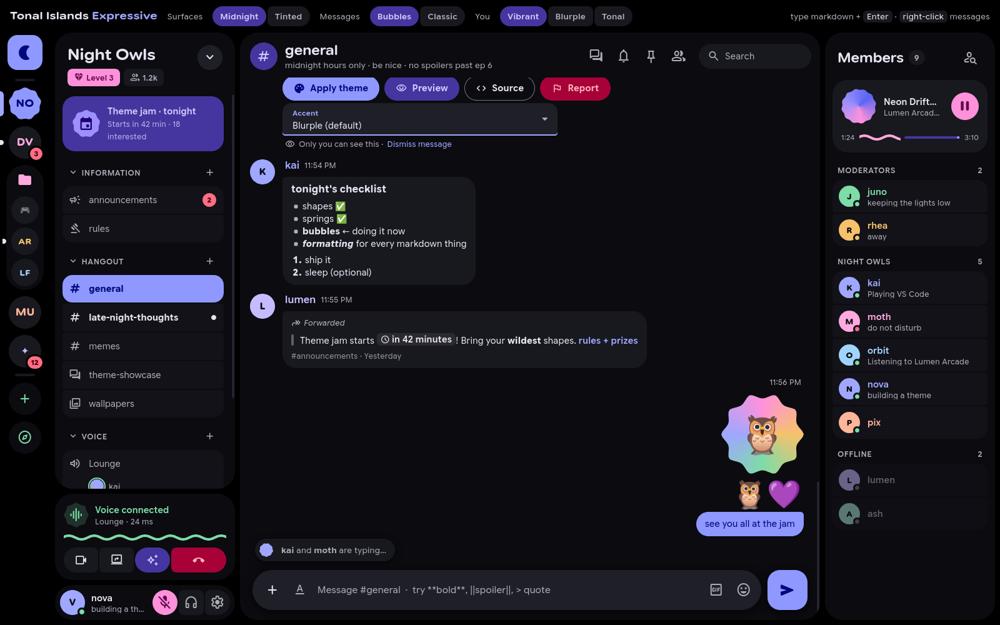
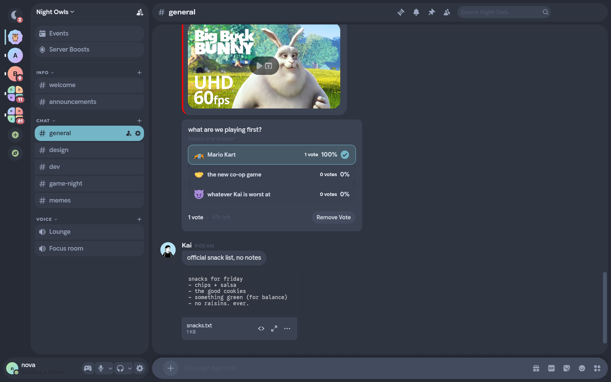
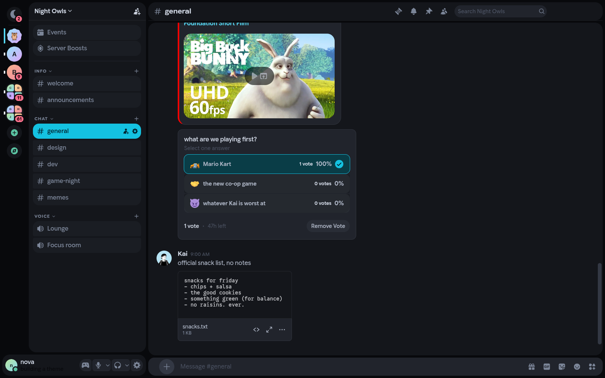

<h1 align="center">M3E Discord</h1>

<h3 align="center">Discord, with a little more personality.</h3>

<p align="center">
Rounded panels, shapes that change when you click them, and chat bubbles that put you on the right. Literally.<br>
Inspired by Google's newest Material design, the playful one on new Android phones. Five looks, one install.
</p>

<p align="center">
<a href="#install-in-under-a-minute"><b>Install</b></a> &nbsp;·&nbsp;
<a href="https://monishbl.github.io/m3e-discord/"><b>Setup page</b></a> &nbsp;·&nbsp;
<a href="#five-looks-pick-a-mood"><b>The looks</b></a> &nbsp;·&nbsp;
<a href="#questions"><b>Questions</b></a>
</p>

<p align="center">

</p>
<p align="center"><sub>The real thing, in a demo server. The names and faces are made up; the friendships are not.</sub></p>

<br>

## Five looks. Pick a mood.

Same theme, five moods. Choose the one that matches your room's lighting.

<table>
<tr>
<td width="50%"><br><b>Midnight.</b> The default. Deep blue-grey with a cyan glow.</td>
<td width="50%"><br><b>Nord.</b> Midnight's Nord colours, exactly. Frosty, calm, a little Scandinavian.</td>
</tr>
<tr>
<td width="50%"><br><b>AMOLED.</b> True black. Your OLED screen says thanks.</td>
<td width="50%"><br><b>Light.</b> For sunny rooms and brave souls.</td>
</tr>
<tr>
<td width="50%"><br><b>Classic.</b> Discord's familiar layout, just better dressed.</td>
<td width="50%"></td>
</tr>
</table>

<br>

## Install in under a minute.

You'll need [Vencord](https://vencord.dev) (or Vesktop).

1. **Open the theme settings.** In Discord: Settings → **Themes** → **Online Themes**.
2. **Paste one link.**

   | Look | Link |
   |---|---|
   | Midnight | `https://raw.githubusercontent.com/monishbl/m3e-discord/main/dist/m3e-midnight.theme.css` |
   | Nord | `https://raw.githubusercontent.com/monishbl/m3e-discord/main/dist/m3e-nord.theme.css` |
   | AMOLED | `https://raw.githubusercontent.com/monishbl/m3e-discord/main/dist/m3e-amoled.theme.css` |
   | Light | `https://raw.githubusercontent.com/monishbl/m3e-discord/main/dist/m3e-light.theme.css` |
   | Classic | `https://raw.githubusercontent.com/monishbl/m3e-discord/main/dist/m3e-classic.theme.css` |

3. **Want to be on the right?** Get your snippet from the [setup page](https://monishbl.github.io/m3e-discord/) and paste it into **QuickCSS**, just below Themes in the same settings.

One look at a time: they don't share the stage well. And keep Discord itself on **Dark**, even for the Light look, which does its own repainting.

<br>

## Make it yours.

Paste this into **QuickCSS** and change the words after the colons:

```css
:root {
  --m3e-bubbles: on;        /* off: plain messages, no bubbles */
  --m3e-accent: auto;       /* or any colour, like #5865f2: text stays readable whatever you pick */
  --m3e-shapes: on;         /* off: round server icons only */
  --m3e-chatbar: floating;  /* or inline */
  --m3e-mine: right;        /* left: your messages stay on the left */
  --m3e-motion: expressive; /* calm: no bounce, nothing swells */
  --m3e-titlebar: off;      /* on: bring back Discord's title bar */
  --m3e-wincontrols: on;    /* off: no minimise / maximise / close buttons */
}
body {
  --gap: 8px;               /* space between panels */
  --m3e-chat-max: 1280px;   /* how wide the messages get; none for edge to edge */
}
```

<br>

## Questions.

<details>
<summary><b>My messages are still on the left.</b></summary>
<br>
Grab your snippet from the <a href="https://monishbl.github.io/m3e-discord/">setup page</a> and paste it into QuickCSS. It needs a profile picture, because Discord's default avatars don't carry your name tag. And if you send more than about 24 messages in a row, the rest drift back to the left. Maybe let someone else talk.
</details>

<details>
<summary><b>Can I pick my own colour?</b></summary>
<br>
Any colour you like: <code>:root { --m3e-accent: #5865f2; }</code> in QuickCSS. The theme keeps your colour's hue and sets how light each part is itself, so text stays readable on every look, even Light. Picked a grey, or the exact colour of the panels? There's no hue to work with, so it quietly falls back to the look's own accent. Back to the original: <code>auto</code>.
</details>

<details>
<summary><b>Nothing bounces.</b></summary>
<br>
The theme turns its animations off when your computer asks for less motion. On Windows that's Settings → Accessibility → Visual effects → <b>Animation effects</b>; in Discord, Settings → Accessibility → <b>Reduced Motion</b>. Turn those back on and the bounce returns. Prefer it still? <code>--m3e-motion: calm</code> keeps the shapes but drops the bounce.
</details>

<details>
<summary><b>Discord updated and something looks off.</b></summary>
<br>
Discord renames its building blocks now and then, and a few pieces of the theme can lose track. <a href="https://github.com/monishbl/m3e-discord/issues">Open an issue</a> with a screenshot and it'll get fixed.
</details>

<details>
<summary><b>Will it slow my Discord down?</b></summary>
<br>
No: it's as quick as the theme it's built on. If your system asks for less motion, the animations politely stand down.
</details>

<details>
<summary><b>The Light look has dark patches.</b></summary>
<br>
Set Discord's own appearance to Dark. The Light look repaints the dark one; Discord's light mode argues with it.
</details>

<details>
<summary><b>Does it work with BetterDiscord?</b></summary>
<br>
It's made for Vencord and Vesktop. BetterDiscord might be fine, but nobody's tried it yet. Be the first.
</details>

<details>
<summary><b>I want to tinker.</b></summary>
<br>

The theme lives in `theme/src/theme.css`, each look's tweaks are in `theme/variants/`, and `node theme/build.mjs` builds them all into `dist/`. Add `--install` to drop them straight into Vencord. Put your ID in `theme/config.json` (copy `config.example.json`) and you won't need the snippet.

To watch changes live, start Discord with `--remote-debugging-port=9222`. Then `node tools/cdp.mjs css dist/dev.css` puts your build on screen. The `tools/` folder also has a lag meter, a contrast checker, and `accent-check.mjs`, which runs every possible accent colour through the theme and checks it stays readable. `mockups/` holds the early sketches this grew from.
</details>

<br>

---

<sub>
Made by <a href="https://github.com/monishbl">monishbl</a> · MIT license. Built on <a href="https://github.com/refact0r/midnight-discord">Midnight</a> by refact0r, which does a lot of the heavy lifting. Colours come from Google's Material colour tools; the font is Google Sans Flex. Not affiliated with Discord or Google. They just make nice things.
</sub>
