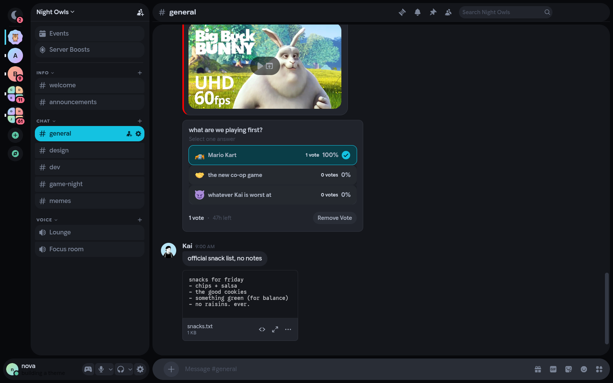
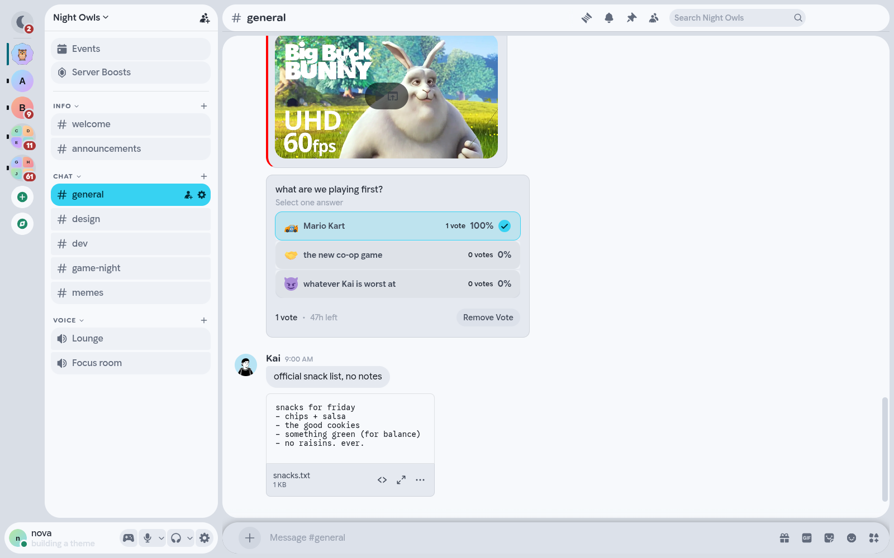
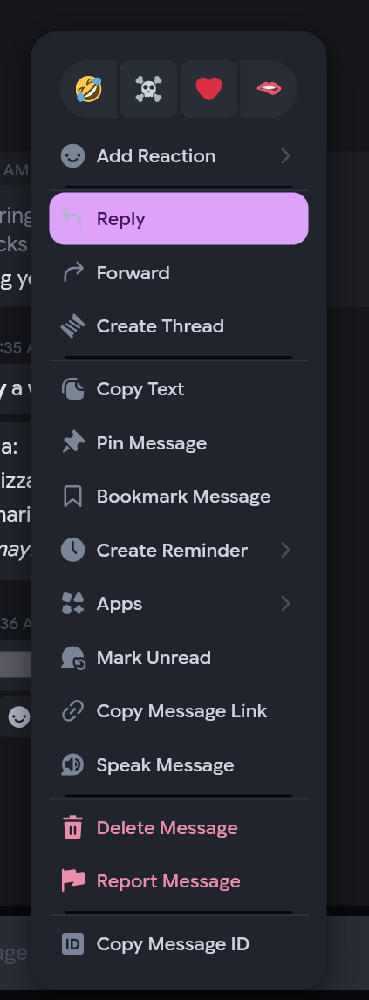

<h1 align="center">M3E Discord</h1>

<h3 align="center">Material. But expressive.</h3>

<p align="center">
Discord in Material 3 Expressive: shapes that morph, springs that settle, bubbles that know which side you're on.<br>
A <a href="https://vencord.dev">Vencord</a> theme on top of refact0r's <a href="https://github.com/refact0r/midnight-discord">Midnight</a>, in four looks.
</p>

<p align="center">
<a href="#one-link-ten-seconds"><b>Install</b></a> &nbsp;·&nbsp;
<a href="https://monishbl.github.io/m3e-discord/"><b>Setup page</b></a> &nbsp;·&nbsp;
<a href="#four-looks-one-theme"><b>The looks</b></a> &nbsp;·&nbsp;
<a href="#questions"><b>Questions</b></a>
</p>

<p align="center">

</p>
<p align="center"><sub>The default look. Every screenshot here is the real theme in a demo server; names and avatars are placeholders.</sub></p>

<br>

## Four looks. One theme.

Same shapes, same motion. Pick the light you're in.

<table>
<tr>
<td width="50%"><br><b>M3E Discord.</b> Midnight's cyan, seeded into a full expressive scheme, on night blue-grey.</td>
<td width="50%"><br><b>AMOLED.</b> A pure black canvas, every surface one step darker. Made for OLED at 2 am.</td>
</tr>
<tr>
<td width="50%"><br><b>Light.</b> Neutral daylight surfaces with the light expressive accents, with text checked for contrast.</td>
<td width="50%"><br><b>Classic.</b> Flat messages and an inline chat bar, the way Discord lays it out. The motion stays.</td>
</tr>
</table>

<br>

## Shapes that mean something.

<table>
<tr>
<td width="42%"></td>
<td>

**The server you're in is a cookie.** Every other one is a circle. The shapes come from Material's own shape library (cookies, flowers, clovers), traced into outlines at build time.

**Lists in segments.** Channels and members sit in tight groups, two pixels apart, with rounded ends. The one you're on becomes a pill.

**Buttons that join up.** Mute, deafen and settings form one connected group. The one you press tightens toward its neighbours.

</td>
</tr>
</table>

<br>

## Yours on the right.

<p align="center"></p>

Other people's messages on the left, yours on the right in your accent, like a messaging app. Runs of messages round off at the ends. A ping gets a soft ring. Code, quotes, lists, spoilers, embeds, polls and reactions are all restyled to match.

Discord doesn't say who sent a follow-up message, so the theme recognises you by your user ID.
**[Get your snippet on the setup page](https://monishbl.github.io/m3e-discord/).** It runs in your browser and nothing is sent anywhere.

<br>

## Press. Don't hover.

<table>
<tr>
<td>

**Hover is a tint.** Point at something and it lightens, 8%, the way Material does it. Nothing changes shape under a passing mouse.

**Press is a shape.** Round buttons square off, list items round out, and connected buttons pinch their inner corners, then spring back when you let go.

**Springs, not curves.** Material's own expressive spring values, from Jetpack Compose, compiled into CSS. Shapes settle without a bounce. Only things that move (the server pill, switches, a menu opening) are allowed to overshoot.

</td>
<td width="34%"></td>
</tr>
</table>

<br>

## Light on its feet.

The "is this mine?" check runs once per message, not once per element, and nothing heavy happens on hover. In testing, hovering a message or switching channels costs the same as Midnight alone.

<br>

## And everything you'd expect.

- A floating chat bar, and a spinning Material cookie as the typing indicator
- Material 3 switches, pill buttons, rounded menus, light tooltips without arrows
- The chat centred in one column at wide sizes, and no title bar
- A member list that folds into an avatar rail on narrow windows
- Badges that stay whole, channel names centred in their pills
- Every colour as a Material role, so all four looks come from the same file

<br>

## One link. Ten seconds.

1. **Open Vencord's themes.** Settings → **Themes** → **Online Themes**.
2. **Paste one link.**

   | Look | Link |
   |---|---|
   | M3E Discord | `https://raw.githubusercontent.com/monishbl/m3e-discord/main/dist/m3e-midnight.theme.css` |
   | AMOLED | `https://raw.githubusercontent.com/monishbl/m3e-discord/main/dist/m3e-amoled.theme.css` |
   | Light | `https://raw.githubusercontent.com/monishbl/m3e-discord/main/dist/m3e-light.theme.css` |
   | Classic | `https://raw.githubusercontent.com/monishbl/m3e-discord/main/dist/m3e-classic.theme.css` |

3. **Put yourself on the right** (optional). Paste your user ID into the [setup page](https://monishbl.github.io/m3e-discord/) and
   copy what it gives you into **QuickCSS**.

Turn on one look only, and not Midnight too: each one already includes it. Keep Discord's own appearance on **Dark** (the Light look repaints it). Works in Vencord and Vesktop.

<br>

## Make it yours.

Change any of these in **QuickCSS**, so updates never overwrite them:

```css
:root {
  --m3e-bubbles: on;        /* off: flat messages */
  --m3e-accent: midnight;   /* blurple · lilac (dark looks) */
  --m3e-shapes: on;         /* off: plain circles for servers */
  --m3e-chatbar: floating;  /* inline */
  --m3e-mine: right;        /* left: keep your messages on the left */
}
body {
  --gap: 8px;               /* space between panels */
  --m3e-island-radius: 28px;
  --m3e-bubble-max: 80%;    /* widest a bubble gets */
  --m3e-chat-max: 1280px;   /* width of the centred chat column; none = full width */
}
```

<br>

## Questions.

<details>
<summary><b>My messages aren't on the right.</b></summary>
<br>
Add the snippet from the <a href="https://monishbl.github.io/m3e-discord/">setup page</a> to QuickCSS. It needs a custom avatar, because Discord's default avatars don't contain your ID. After about 24 messages in a row from you, the rest fall back to the left.
</details>

<details>
<summary><b>Something looks off after a Discord update.</b></summary>
<br>
Discord's class names change with its builds, and some selectors may need refreshing. Midnight's part updates itself.
<a href="https://github.com/monishbl/m3e-discord/issues">Open an issue</a> with a screenshot.
</details>

<details>
<summary><b>Does it slow Discord down?</b></summary>
<br>
It shouldn't. Hovering a message and switching channels measured the same as Midnight alone. If you have
<code>prefers-reduced-motion</code> on, the animations switch off.
</details>

<details>
<summary><b>The Light look has dark patches.</b></summary>
<br>
Set Discord's own appearance to Dark. The Light look repaints the dark palette, and Discord's light mode fights it.
</details>

<details>
<summary><b>Does it work with BetterDiscord?</b></summary>
<br>
It's made and tested for Vencord and Vesktop. BetterDiscord reads the same kind of file, but it's untested there.
</details>

<details>
<summary><b>I want to change the theme itself.</b></summary>
<br>

The source is `theme/src/theme.css`, one override file per look is in `theme/variants/`, and `node theme/build.mjs` writes `dist/`. Add `--install` to copy the built themes into Vencord's themes folder; with your ID in `theme/config.json` (see `config.example.json`) you won't need the snippet.

To test live, start Discord with `--remote-debugging-port=9222`:
- `node tools/cdp.mjs css dist/dev.css` puts your build on screen.
- `tools/matched.mjs` shows which rules win.
- `tools/navbench.mjs` measures page switches.
- `tools/contrast.js` finds text under 4.5:1.

`mockups/` holds the early HTML concepts the theme grew from. They aren't the theme.
</details>

<br>

---

<sub>
By <a href="https://github.com/monishbl">monishbl</a> · MIT. Built on <a href="https://github.com/refact0r/midnight-discord">Midnight</a> by refact0r (MIT). Colour schemes from Google's material-color-utilities (Apache-2.0). Google Sans Flex comes from Google Fonts; the mockups bundle it under the SIL Open Font License. Not affiliated with Discord or Google.
</sub>
