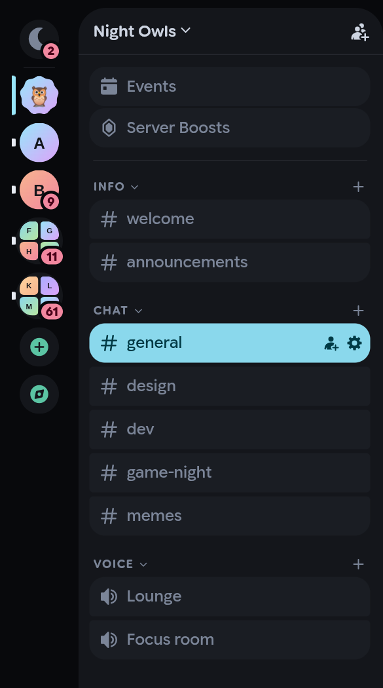
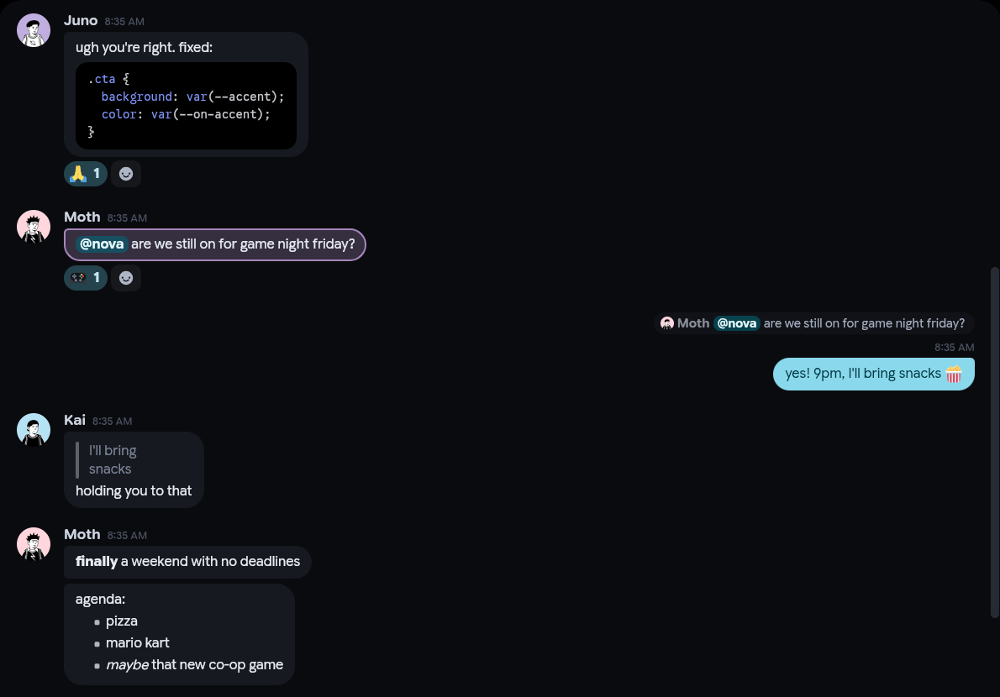
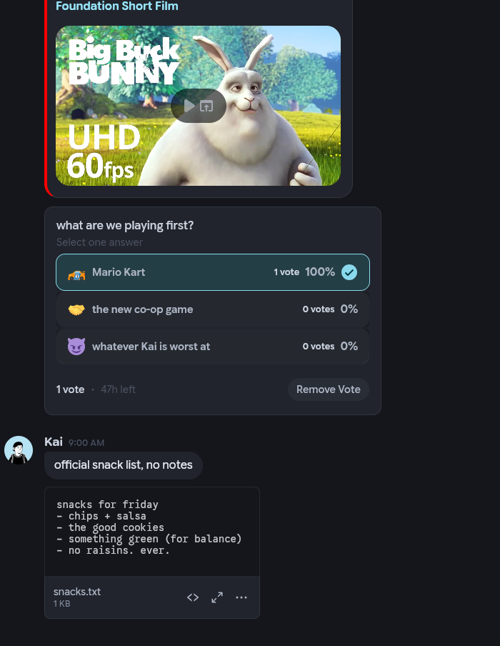

<h1 align="center">M3E Discord</h1>

<h3 align="center">Discord, with a little more personality.</h3>

<p align="center">
Rounded panels, shapes that change when you click them, and chat bubbles that put you on the right. Literally.<br>
Inspired by Google's newest Material design, the playful one on new Android phones. Four looks, one install.
</p>

<p align="center">
<a href="#install-in-under-a-minute"><b>Install</b></a> &nbsp;·&nbsp;
<a href="https://monishbl.github.io/m3e-discord/"><b>Setup page</b></a> &nbsp;·&nbsp;
<a href="#four-looks-pick-a-mood"><b>The looks</b></a> &nbsp;·&nbsp;
<a href="#questions"><b>Questions</b></a>
</p>

<p align="center">

</p>
<p align="center"><sub>The real thing, in a demo server. The names and faces are made up; the friendships are not.</sub></p>

<br>

## Four looks. Pick a mood.

Same theme, four moods. Choose the one that matches your room's lighting.

<table>
<tr>
<td width="50%"><br><b>Midnight.</b> The default. Deep blue-grey with a cyan glow.</td>
<td width="50%"><br><b>AMOLED.</b> True black. Your OLED screen says thanks.</td>
</tr>
<tr>
<td width="50%"><br><b>Light.</b> For sunny rooms and brave souls.</td>
<td width="50%"><br><b>Classic.</b> Discord's familiar layout, just better dressed.</td>
</tr>
</table>

<br>

## Shapes with a sense of occasion.

<table>
<tr>
<td width="42%"></td>
<td>

**The server you're in gets a cookie.** A cookie shape, anyway. The others stay round and wait their turn.

**Channels stack up neatly.** Little rounded groups, and the one you're reading turns into a soft pill.

**Your buttons stick together.** Mic, headphones and settings sit side by side like they planned it.

</td>
</tr>
</table>

<br>

## You're right. Literally.

<p align="center"></p>

Your messages sit on the right and everyone else's on the left, like your texting app. When someone mentions you, their message gets a soft outline so it doesn't slip past. Pictures, videos, links, files, polls, code and spoilers all get the same rounded treatment.

Discord doesn't tell themes who wrote which message, so you introduce yourself once. It takes ten seconds on the **[setup page](https://monishbl.github.io/m3e-discord/)**, and nothing leaves your browser.

<br>

## Bring the whole group chat.

<table>
<tr>
<td width="44%"></td>
<td>

**Photos and videos** get rounded frames that match everything else. Even Big Buck Bunny looks better with soft corners.

**Polls** look like proper buttons, and your pick gets a tick.

**Files** show a little preview, so the snack list can be judged before anyone opens it.

**Links** turn into tidy cards instead of walls of text.

</td>
</tr>
</table>

<br>

## It moves when you mean it.

<table>
<tr>
<td>

**Point at something** and it lights up a little. That's it. No jumping around while your mouse is just passing through.

**Click it** and it changes shape: round buttons go a bit square, list items round out. Let go and it settles back, smooth and calm.

**Menus open with a little spring,** and the item you're pointing at turns into a pill.

</td>
<td width="34%"></td>
</tr>
</table>

<br>

## Pretty, but not slow.

It's as quick as the theme it's built on. Hovering, scrolling and switching channels were all measured, more than once, by someone who really cares about lag.

<br>

## Also in the box.

- A floating message box, and a little spinning cookie when someone's typing
- Proper toggle switches, pill-shaped buttons and rounded menus
- On a big screen, the chat stays centred so your eyes don't have to travel
- On a small window, the member list shrinks to just faces
- No title bar, just your chats
- Unread badges that stay whole and names that sit straight

<br>

## Install in under a minute.

You'll need [Vencord](https://vencord.dev) (or Vesktop).

1. **Open the theme settings.** In Discord: Settings → **Themes** → **Online Themes**.
2. **Paste one link.**

   | Look | Link |
   |---|---|
   | Midnight | `https://raw.githubusercontent.com/monishbl/m3e-discord/main/dist/m3e-midnight.theme.css` |
   | AMOLED | `https://raw.githubusercontent.com/monishbl/m3e-discord/main/dist/m3e-amoled.theme.css` |
   | Light | `https://raw.githubusercontent.com/monishbl/m3e-discord/main/dist/m3e-light.theme.css` |
   | Classic | `https://raw.githubusercontent.com/monishbl/m3e-discord/main/dist/m3e-classic.theme.css` |

3. **Want to be on the right?** Get your snippet from the [setup page](https://monishbl.github.io/m3e-discord/) and paste it into **QuickCSS**, just below Themes in the same settings.

One look at a time: they don't share the stage well. And keep Discord itself on **Dark**, even for the Light look, which does its own repainting.

<br>

## Make it yours.

Paste this into **QuickCSS** and change the words after the colons:

```css
:root {
  --m3e-bubbles: on;        /* off: plain messages, no bubbles */
  --m3e-accent: midnight;   /* or blurple, or lilac */
  --m3e-shapes: on;         /* off: round server icons only */
  --m3e-chatbar: floating;  /* or inline */
  --m3e-mine: right;        /* left: your messages stay on the left */
}
body {
  --gap: 8px;               /* space between panels */
  --m3e-chat-max: 1280px;   /* how wide the chat gets; none for edge to edge */
}
```

<br>

## Questions.

<details>
<summary><b>My messages are still on the left.</b></summary>
<br>
Grab your snippet from the <a href="https://monishbl.github.io/m3e-discord/">setup page</a> and paste it into QuickCSS. It needs a profile picture, because Discord's default avatars don't carry your name tag. And if you send more than about 24 messages in a row, the rest drift back to the left. Maybe let someone else talk.
</details>

<details>
<summary><b>Discord updated and something looks off.</b></summary>
<br>
Discord renames its building blocks now and then, and a few pieces of the theme can lose track. <a href="https://github.com/monishbl/m3e-discord/issues">Open an issue</a> with a screenshot and it'll get fixed.
</details>

<details>
<summary><b>Will it slow my Discord down?</b></summary>
<br>
No: it's as quick as the theme it's built on. If your system asks for less motion, the animations politely stand down.
</details>

<details>
<summary><b>The Light look has dark patches.</b></summary>
<br>
Set Discord's own appearance to Dark. The Light look repaints the dark one; Discord's light mode argues with it.
</details>

<details>
<summary><b>Does it work with BetterDiscord?</b></summary>
<br>
It's made for Vencord and Vesktop. BetterDiscord might be fine, but nobody's tried it yet. Be the first.
</details>

<details>
<summary><b>I want to tinker.</b></summary>
<br>

The theme lives in `theme/src/theme.css`, each look's tweaks are in `theme/variants/`, and `node theme/build.mjs` builds them all into `dist/`. Add `--install` to drop them straight into Vencord. Put your ID in `theme/config.json` (copy `config.example.json`) and you won't need the snippet.

To watch changes live, start Discord with `--remote-debugging-port=9222`. Then `node tools/cdp.mjs css dist/dev.css` puts your build on screen. The `tools/` folder also has a lag meter and a contrast checker. `mockups/` holds the early sketches this grew from.
</details>

<br>

---

<sub>
Made by <a href="https://github.com/monishbl">monishbl</a> · MIT license. Built on <a href="https://github.com/refact0r/midnight-discord">Midnight</a> by refact0r, which does a lot of the heavy lifting. Colours come from Google's Material colour tools; the font is Google Sans Flex. Not affiliated with Discord or Google. They just make nice things.
</sub>
